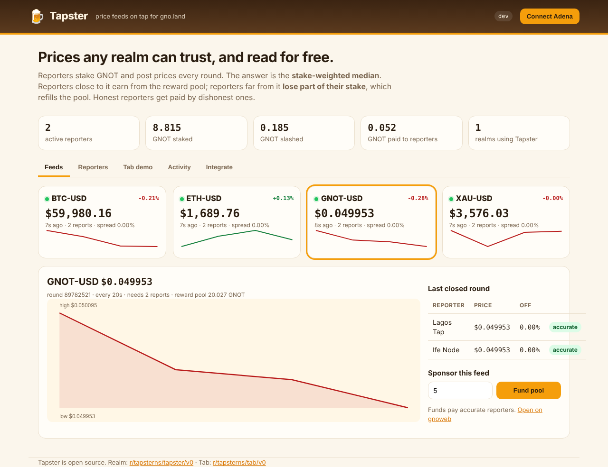
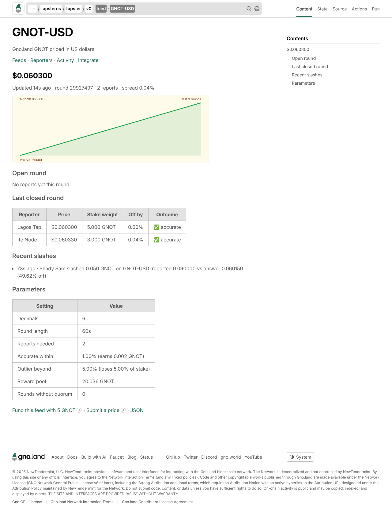
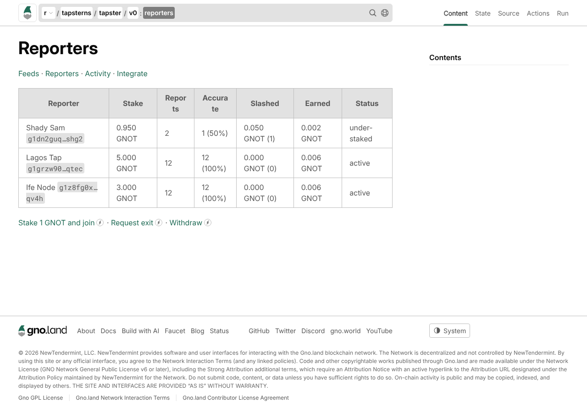
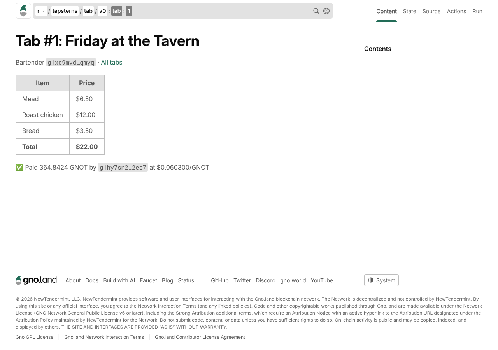

# 🍺 Tapster: price feeds on tap for gno.land

**Staked, slashable price feeds that any realm can read for free.**

gno.land has a DEX, wallets, DAOs and plenty of escrow apps, but no general price oracle. Anything that wants to charge in dollars, lend against collateral, trigger a stop-loss or settle a bet on a price has to trust one off-chain operator, or not get built. Tapster fills that gap with a small, readable oracle built the Gno way: the rules are the source code, and the realm renders its own dashboard on gnoweb.

| | |
|---|---|
| Oracle realm | `gno.land/r/<deployer>/tapster/v0` |
| Math package | `gno.land/p/<deployer>/tapmath/v0` |
| Demo consumer | `gno.land/r/<deployer>/tab/v0` |
| Network | Onyx testnet (`onyx-1`) |
| Feeds | GNOT-USD, BTC-USD, ETH-USD, XAU-USD (gold) |

> After deploying, replace `<deployer>` above with the address `deploy.sh` prints.



## How it works

1. **Stake.** A reporter stakes at least 1 GNOT with `Stake`.
2. **Report.** Each feed runs in fixed rounds (5 minutes by default). Reporters submit one price per round with `Submit`.
3. **Aggregate.** When a round closes, the answer is the **stake-weighted median** of the reports. Moving it requires controlling half of the staked weight, so influence costs stake.
4. **Reward.** Reporters within 1% of the answer are paid from the feed's reward pool. Anyone can top up a pool with `Fund`.
5. **Slash.** Reporters more than 5% away lose 5% of their stake, which goes into the reward pool. Honest reporters are paid by dishonest ones.
6. **Read.** Any realm calls `PriceFresh` or `MustPriceFresh` for free and refuses stale data.

Rounds close lazily: the first report of a new round finalizes the previous one, and anyone can call `Finalize`. There is no keeper to trust and nothing runs off-chain except the reporters themselves.

### Safety properties

- **Payment guard.** Every function that accepts GNOT checks `cur.Previous().IsUserCall()` together with `OriginSend()`, following the Gno security guide, so an intermediate realm or a `maketx run` script cannot fake a payment. Regression tests cover both attack shapes.
- **No escape from a bad report.** Exiting starts an unbonding period, and stake stays slashable during it. `Withdraw` first settles any finished round that holds the reporter's report, and refuses while one is still open.
- **Bounded admin.** The admin can add feeds and tune parameters, but slashing is hard-capped at 20% per report, tolerance must stay below the outlier threshold, and the admin can never move anyone's stake.
- **No pointer leaks.** All exported reads return plain values. State lives in unexported `avl` trees.
- **Deterministic integer math.** `tapmath` has no floats. Unit conversions round in the payer-safe direction and are overflow-checked.
- **Validate before write.** Entry points validate every input before touching state.

## Use Tapster from your realm

```go
import (
    "gno.land/r/<deployer>/tapster/v0"
    "gno.land/p/<deployer>/tapmath/v0"
)

func init(cur realm) {
    // Optional: list your realm under "Used by" on Tapster's page.
    tapster.RegisterConsumer(cross(cur), "what my realm does")
}

func Checkout(cur realm, usdCents int64) {
    price, dec := tapster.MustPriceFresh("GNOT-USD", 600) // panics if older than 10 min
    due := tapmath.UsdCentsToUgnot(usdCents, price, dec)  // rounds up
    // ... require the -send amount to cover due, then settle
}
```

| Read function | Returns |
|---|---|
| `Latest(pair)` | price, decimals, updatedAt, round, ok |
| `PriceFresh(pair, maxAgeSecs)` | price, decimals, ok (false when stale) |
| `MustPriceFresh(pair, maxAgeSecs)` | price, decimals (panics when stale) |
| `History(pair, n)` | `unix:price` list, oldest first |
| `Pairs()`, `Consumers()`, `MinStake()`, `ReporterStake(addr)` | plain values |

Off-chain clients can read JSON from `Render`: `:json`, `:json/<PAIR>` and `:json/reporters`.

## Tab: the demo consumer

`r/tab` is a bar tab priced in US dollars and paid in GNOT. A bartender opens a tab and adds items in cents. When a customer pays, the realm:

1. reads GNOT-USD from Tapster and refuses a price older than 10 minutes,
2. converts the bill with `tapmath.UsdCentsToUgnot` (rounding up),
3. pays the bartender exactly the amount due, and
4. refunds any extra GNOT the customer sent.

On a live chain, a $22.00 tab at $0.0603/GNOT paid the bartender exactly 364.842455 GNOT, and the 2% buffer came back to the payer. Tab registers itself as a Tapster consumer in its `init`, so the oracle's page shows it under "Used by".

## gnoweb pages (rendered by the realm)

| Path | Shows |
|---|---|
| `tapster/v0` | every feed, price, age, spread, reward pool, SVG trend line |
| `tapster/v0:feed/GNOT-USD` | price chart, open round, last round's reports with outcomes, recent slashes, parameters |
| `tapster/v0:reporters` | leaderboard by stake: accuracy, slashes, earnings |
| `tapster/v0:activity` | joins, slashes, funding, new consumers |
| `tapster/v0:integrate` | copy-paste integration guide |
| `tab/v0`, `tab/v0:tab/1` | tabs, live GNOT quote, one-click pay link |

Every action has a transaction link, so the whole protocol can be used from gnoweb with Adena and no other frontend.

| Feed page on gnoweb | Reporter leaderboard | Tab paid in GNOT |
|---|---|---|
|  |  |  |

## Repository

```
gno/p/tapmath/   pure math: weighted median, deviation, USD<->ugnot, formatting (+10 tests)
gno/r/tapster/   the oracle realm: staking, rounds, slashing, rewards, reads, gnoweb UI (+14 tests)
gno/r/tab/       demo consumer realm (+4 tests, incl. exact coin balances)
bot/             reporter bot (Node 18+, no dependencies)
web/index.html   web app: live feeds, charts, staking and Tab flows via Adena
deploy.sh        one-command deploy to onyx-1
```

## Run it

### Deploy (about 5 minutes)

```sh
./deploy.sh              # downloads gnokey, creates key tapster-admin, deploys all three packages
./deploy.sh reporters    # optional: 2 more reporter keys, funded and staked
./deploy.sh status       # check whether onyx's approver has enabled the packages
```

The script asks you to fund the new address from [faucet.gno.land](https://faucet.gno.land) (about 40 GNOT). It rewrites the package paths to your address's namespace, writes your address as admin, submits the packages in dependency order, and waits for the testnet approver. Onyx stores new packages as inert until the approver enables them.

### Report prices

```sh
cd bot
cp .env.example .env     # deploy.sh already did this for you
node reporter.mjs --dry-run   # show prices from the exchanges, submit nothing
node reporter.mjs             # report every round
```

The bot takes the median of CoinGecko, Kraken, Coinbase, OKX and KuCoin (whichever list the pair). It skips a round when sources disagree by more than 2%, so an honest reporter is never slashed for a bad exchange. XAU-USD uses PAX Gold (1 token = 1 troy ounce). For a live slashing demo, set `CHAOS_KEY=tapster-r3` and that key reports 30% high.

### Web app

Open `dist/index.html` (written by `deploy.sh`), or host `web/index.html` anywhere and add `?ns=<deployer address>`. It reads the chain directly over RPC and signs with Adena. If the realm can't be reached, it shows clearly labeled demo data.

### Tests

```sh
gno test ./gno/p/tapmath ./gno/r/tapster ./gno/r/tab
```

The 28 tests cover the median and weighted median, the conversions, the staking rules and the code-realm payment bypass. They also cover rewards and slashing, stake weight beating cheap liars, quorum, lazy finalization, freshness, the unbonding and open-round escape, admin bounds, rendering and Tab payments with exact balances.

## Roadmap

- Mainnet deployment once the hackathon closes, then monthly releases.
- More pairs (SOL, USDC peg monitor, NGN-USD) and per-feed heartbeat updates.
- A `p/` client package with TWAP helpers over `History`.
- Reporter reputation that decays, using the cross-realm reputation work in the ecosystem.

## License

MIT.
